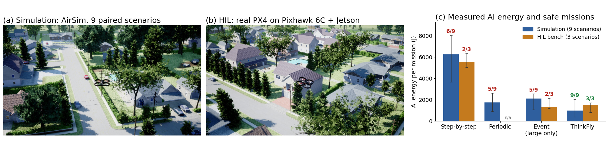

# ThinkFly pilot: drone AI that thinks in proportion to need

Proof-of-concept results for the ThinkFly project (University of West London with the University of Glasgow).

**Reviewers: start here → https://abdul-mannan-khan.github.io/thinkfly-pilot/** (videos play in the page; results with intervals; scoring rules; limits).

ThinkFly makes an AI agent spend reasoning energy only when the mission needs it:

1. **When to think.** Event triggers (new information, a battery margin about to be crossed, stalled progress) decide when the agent reasons. Between triggers, ordinary flight controllers fly the current plan.
2. **How much to think.** A small language model on the drone proposes a plan. A rule checker tests it on the map (no-fly zones, battery reserve at home, no target dropped without reason). Only a plan that fails the check raises an alarm, and only then is a large model at the ground station called.
3. **Measure it.** Every model call is metered in joules.

*Proof of concept in AirSim: (a) simulation, nine paired scenarios; (b) hardware-in-the-loop bench, real PX4 on a Pixhawk 6C with the small model on a Jetson Orin Nano; (c) measured AI energy per mission (median and range) and missions completed safely. Made by `code/make_poc_figure_airsim.py`.*

## Videos

All videos play in the browser on the reviewer page: **https://abdul-mannan-khan.github.io/thinkfly-pilot/#videos**

| Video | Link |
|---|---|
| **Hardware in the loop with AirSim (4 Nov 2026).** Real PX4 on a Pixhawk 6C in HITL mode, AirSim physics and sensors; ThinkFly and the small model on a Jetson Orin Nano; live bench footage (chase camera, 4 frames/s) | [watch](https://abdul-mannan-khan.github.io/thinkfly-pilot/media/ThinkFly_HITL_AirSim.mp4) |
| **Nine paired AirSim scenarios**, all four agents side by side (top-down replay from the logs) | [watch](https://abdul-mannan-khan.github.io/thinkfly-pilot/media/ThinkFly_AirSim_paired9.mp4) |
| AirSim neighbourhood, first run (chase camera) | [watch](https://abdul-mannan-khan.github.io/thinkfly-pilot/media/ThinkFly_AirSim.mp4) |
| Earlier run (3 Nov): Isaac Sim city + PX4 SITL, one scenario | [watch](https://abdul-mannan-khan.github.io/thinkfly-pilot/media/ThinkFly_Isaac_SITL.mp4) |
| Earlier run (3 Nov): PX4 SIH on a Pixhawk 6C, mirrored in Isaac Sim | [watch](https://abdul-mannan-khan.github.io/thinkfly-pilot/media/ThinkFly_HIL.mp4) |

## The mission

Inspect four house rooftops (A–D) in the AirSim AirSimNH neighbourhood and come home with at least 20 % battery. Three surprises arrive as plain-language messages during the flight:
- a temporary no-fly zone over one target (25–44 s);
- a sudden battery drop of about 13 % (60–83 s);
- an extra target E from the operator (96–114 s).

Four agents fly the same scenario:
- **Step-by-step:** the large model is called every ~9 s, with a growing history.
- **Periodic:** the large model re-plans every 30 s.
- **Event-triggered:** event triggers, but the large model only.
- **ThinkFly:** event triggers, the small model, the rule checker, and the large model only on an alarm.

Models: Qwen3.5-4B (small, 4-bit) and Qwen3.5-27B (large, 4-bit), served by llama.cpp with JSON-schema constrained output.

## Results

### 1. AirSim, nine paired scenarios (main evidence)

This run uses the same neighbourhood and seeds 0–8, and every agent meets the same events. The no-fly zone is fixed per scenario, over one target chosen from the seed. Scoring is in `code/build_site.py`.

| Agent | AI energy per mission, median (range) | Baseline ÷ ThinkFly, paired median (range) | Large / small calls | Safe completions (95 % CI) |
|---|---|---|---|---|
| Step-by-step | 6,266 J (3,664–8,036) | 6.6× (2.0–16.2×) | 13.0 / 0 | 6/9 (30–93 %) |
| Periodic | 1,767 J (915–2,638) | 2.0× (0.6–4.5×) | 4.0 / 0 | 5/9 (21–86 %) |
| Event-triggered (large only) | 2,129 J (1,091–2,562) | 2.1× (0.7–6.5×) | 4.0 / 0 | 5/9 (21–86 %) |
| **ThinkFly** | **1,002 J (392–2,049)** | – | 1.1 / 4.3 | **9/9 (66–100 %)** |

- ThinkFly completed all nine missions safely. Each baseline broke a rule in 3–4 of the nine, mostly by landing below the 20 % battery reserve after the battery drop.
- The baselines do not use a rule checker, so ThinkFly's safety advantage comes from checking every plan before flying it. The energy advantage comes from calling the large model rarely: 1.1 times per mission instead of 4–13.
- Targets inspected were similar: 74 % for ThinkFly and 73–81 % for the baselines.
- In 2 of the 9 scenarios, periodic or event-triggered used less energy than ThinkFly; the ranges above show this.
- The per-mission table is on the reviewer page.

### 2. Hardware in the loop with AirSim (PX4 HITL, 4 November 2026)

The Pixhawk 6C runs real PX4 1.15.1 in HITL mode; AirSim computes the drone's physics and sensors and PX4 flies on them. ThinkFly and the small model run on the Jetson Orin Nano (energy from its VDD_IN rail, idle subtracted); the large model runs on a ground-station GPU. Same paired AirSimNH scenarios (seeds 0–2); propellers off. The NFZ exit fix (see the reviewer page) is included.

| Agent | AI energy, scenarios 1 / 2 / 3 | Large / small calls | Safe completions |
|---|---|---|---|
| Step-by-step | 6,340 / 5,544 / 5,049 J | 12–14 / 0 | 2/3 (scenario 1: landed with 17.1 %) |
| Event-triggered (large only) | 2,159 / 1,198 / 1,350 J | 3–5 / 0 | 2/3 (scenario 1: landed with 19.5 %) |
| **ThinkFly** | **838 / 1,736 / 1,516 J** | 1–3 / 3–5 | **3/3** |

- ThinkFly was the only agent that was safe in all three missions, and it used 3.2–7.6 times less AI energy than step-by-step.
- It used more energy than event-triggered reasoning in scenarios 2 and 3, because the rule checker escalated faulty small-model plans to the large model. A better onboard model (WP2) should remove that cost.
- Three scenarios is a small sample. The horizontal geofence was off for these runs (missions reach about 210 m), as the bench rules allow.

### 3. Earlier single-scenario runs (3 November 2026)

Isaac Sim SITL, PX4 SIH hardware in the loop mirrored in Isaac Sim, and the first AirSim run

#### Software in the loop (Isaac Sim 5.1 + PX4 v1.15 SITL; both models on an RTX 4090, NVML energy counter, idle subtracted)

| Agent | AI energy per mission | Large / small calls | Targets inspected | Rule violations |
|---|---|---|---|---|
| Step-by-step | 5,002 J | 12 / 0 | A, B | 0 |
| Event-triggered (large only) | 1,512 J | 3 / 0 | A, B | 0 |
| **ThinkFly** | **468 J** | 0 / 5 (5 of 5 passed the checker) | A, B, D, E | 0 |

ThinkFly used 10.7 times less measured reasoning energy than step-by-step, and 3.2 times less than event-triggered reasoning with the large model only.

The periodic agent did not finish: the simulator stalled. The coverage difference comes from one conservative large-model decision at take-off, so the claim here is about energy and safety, not coverage.

#### Hardware in the loop (props-off bench)

Setup:
- **Flight controller:** a Pixhawk 6C running PX4 1.15.1 in SIH mode, so the board itself computes the vehicle physics.
- **Onboard computer:** the mission code and the small model run on a Jetson Orin Nano (25 W mode). Energy comes from its INA3221 VDD_IN rail, with idle power subtracted.
- **Large model:** on a ground-station GPU, metered there for each request.

| Agent | AI energy per mission | Large / small calls | Targets inspected | Rule violations |
|---|---|---|---|---|
| Step-by-step | 5,027 J | 11 / 0 | A | 0 |
| Event-triggered (large only) | 1,581 J | 3 / 0 | A, B | 0 |
| **ThinkFly** | **1,890 J** (small 392, large 1,498) | 3 / 5 (2 of 5 passed) | A, E | 0 |

- On the Jetson, one small-model plan cost about 80 J and took about 6 s. On the RTX 4090 it cost 75–126 J and took 0.4–0.7 s.
- After the battery drop, three small-model plans were inconsistent, for example "fly to B" while also skipping B. The rule checker rejected all three and escalated them to the large model, so the mission stayed safe.
- The escalations cost energy. In this test ThinkFly used 2.7 times less energy than step-by-step, but 1.2 times *more* than event-triggered reasoning with the large model only.
- The next step is a more reliable onboard model: distilled from the large model's decisions on escalated cases, and checked by a temporal-logic monitor.

#### Second simulator: AirSim (AirSimNH suburban neighbourhood, SimpleFlight)

The mission code, models, checker and energy meter are the same as in setting 1. The targets are house rooftops 90–210 m from the start, flown at 35 m.

| Agent | AI energy per mission | Large / small calls | Targets inspected | Rule violations |
|---|---|---|---|---|
| Step-by-step | 7,558 J | 16 / 0 | C, B, E | **1** (landed with 17.5 %, below the 20 % reserve) |
| Periodic | 1,722 J | 3 / 0 | C | 0 |
| Event-triggered (large only) | 2,239 J | 4 / 0 | C | 0 |
| **ThinkFly** | **386 J** | 0 / 4 (4 of 4 passed) | A, B | 0 |

- ThinkFly used 19.6 times less energy than step-by-step, 4.5 times less than periodic and 5.8 times less than event-triggered.
- No agent had a physical collision.
- Caveat: in this scenario the no-fly zone is placed on each agent's current route when it fires, so it fell in different places for ThinkFly and for the other agents. The comparison is therefore less tightly paired than in settings 1 and 2.

## What this pilot does not show yet

- Large samples. The AirSim simulation has nine paired scenarios and the AirSim HITL bench three, so the intervals are wide.
- Free flight. The HIL test is a bench test with the propellers off.
- Triggers derived from control theory. The pilot's thresholds are set by hand.
- A temporal-logic checker. The pilot's checker is geometric and battery-based.
- A real battery model. The pilot uses a simple linear time and distance model.

## Code

`code/` contains the following.

| File | Purpose |
|---|---|
| `thinkfly_mission.py` | The four agents, triggers, scenario generator and mission loop. Flies PX4 through MAVLink offboard position setpoints. |
| `ai.py` | Model calls, the NVML and Jetson energy meters, prompts, the JSON schema and the rule checker. |
| `citymap.py` | The city occupancy grid, A* routing, no-fly zones and the battery cost model. |
| `thinkfly_hil.py` | The runner for the Jetson companion computer with a real Pixhawk. |
| `energy_proxy.py` | Ground-station energy metering for each large-model request. |
| `thinkfly_airsim.py`, `airsim_rpc.py` | The same mission in Microsoft AirSim (AirSimNH). |
| `analyze.py`, `make_video.py` | Summary tables, figures and videos. |
| `test_mock.py` | An offline dry run with mock models: `cd code && python3 test_mock.py`. |
| `px4_offboard.py` | A minimal pymavlink offboard helper. |

`scene/urban_isaac.json` holds the building boxes of the city scene. `results/` holds every mission log (`mission_<seed>_<agent>.json`), with each model call's tokens, latency and energy.

## Licence

MIT. Contact: Dr Abdul Manan Khan, University of West London.
